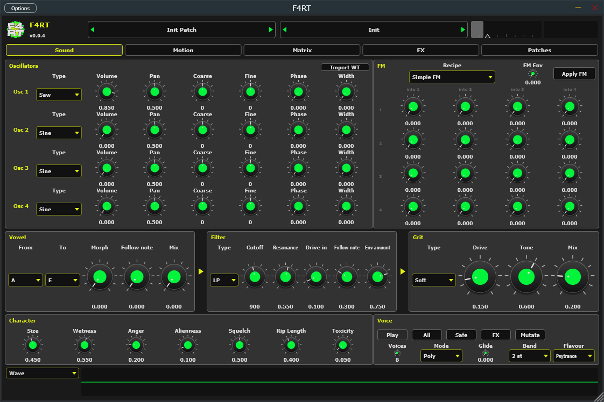
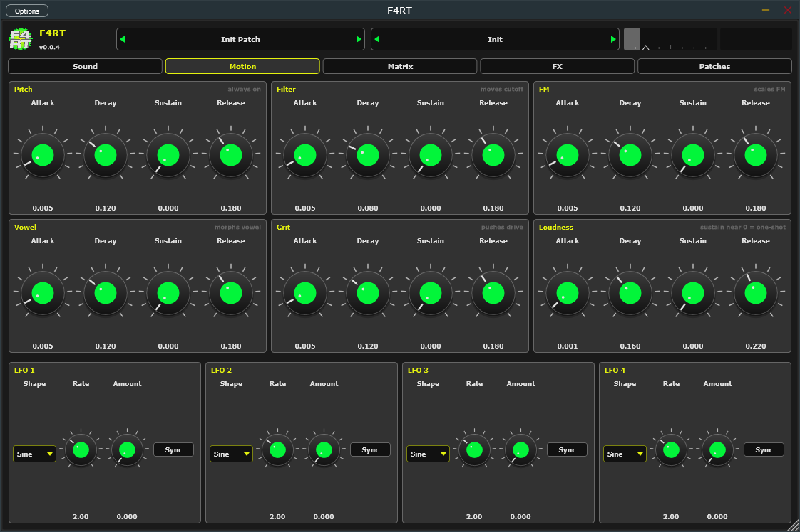
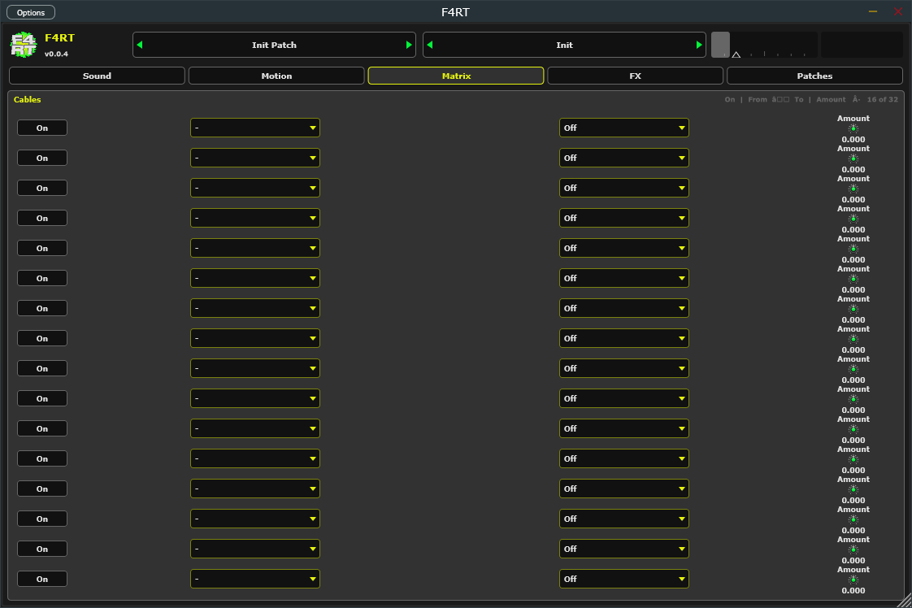
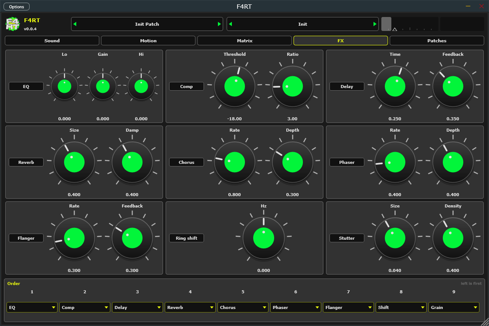
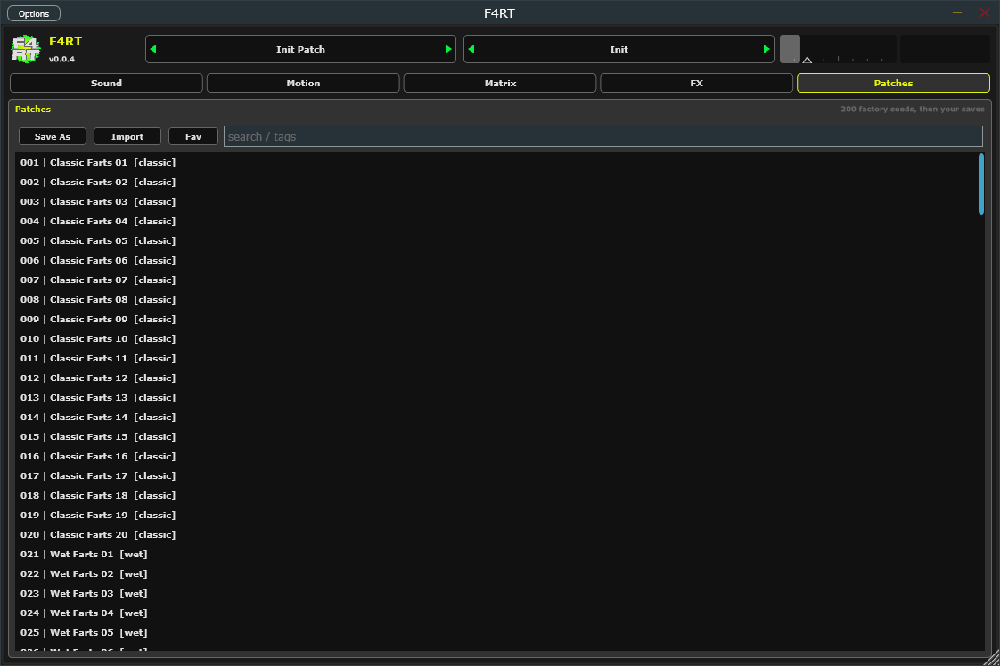

# F4RT manual

MIDI note-on starts a voice. Pitch follows the note. MPE channel pitch-bend and channel pressure are read. Mod wheel is a matrix source.

Hover any control for a short explanation.

## Top bar

Left to right:

- **Logo / F4RT / version** — click for About. **Check for update** asks GitHub for tags; **Open releases** opens the release page.
- **Patch bar** — `<` `>` step through all patches (200 factory, then your saved ones). Click the name for the menu: Init, Save, Save As, Export, Import, every factory category, and User patches.
- **Bank bar** — the current category. `<` `>` jump to the first patch of the previous / next category, click for the category list.
- **Volume strip** — drag (or double-click to reset) the Level fader; the right half is the output spectrum. Both flash yellow when the output clips.

Under that, five tabs: **Sound**, **Motion**, **Matrix**, **FX**, **Patches**.

Saved patches go to `%APPDATA%\Stupid Systems LLC\F4RT\Patches` as `.f4rtp`. Loading a factory patch starts from Init, so FX and matrix settings from the previous patch are cleared.

## Sound

The chain on one screen: Oscillators, FM, Vowel → Filter → Grit, Character, Voice, and a scope.

- **Oscillators** — Osc 1–4: Type, Volume, Pan, Coarse, Fine, Phase, Width. **Import WT** loads a wav as the user wavetable.
- **FM** — 4×4 amounts (row into column). **Recipe** does nothing until **Apply FM**. **FM Env** scales the amounts.
- **Vowel** — From, To, Morph, Follow note, Mix.
- **Filter** — Type, Cutoff, Resonance, Drive in, Follow note, Env amount.
- **Grit** — Type, Drive, Tone, Mix.
- **Character** — Size, Wetness, Anger, Alienness, Squelch, Rip Length, Toxicity.
- **Voice** — **Play** (C3 preview), Voices, Mode (Poly / mono / legato), Glide, Bend, **Flavour**, then All / Safe / FX / Mutate.
- **Scope** — Wave, Spectrum, Spectrogram, FM, Env, Matrix.

## Motion

Six envelopes (Pitch, Filter, FM, Vowel, Grit, Loudness) with Attack / Decay / Sustain / Release, then four LFOs (Shape, Rate, Amount, **Sync**). Loudness sustain near zero is a one-shot toot (“sustain near 0 = one-shot”).

## Matrix

**Cables** — first 16 of 32 (On, From, To, Amount). A route does nothing until its **On** switch is lit. Remaining slots exist as automatable params. Source **Mod wheel** is MIDI CC1.

## FX

Enable buttons: EQ, Comp, Delay, Reverb, Chorus, Phaser, Flanger, **Ring shift**, **Stutter**. Knobs do nothing while that effect is off. **Order** combos set the chain (left is first); slots 8 and 9 are named **Shift** and **Grain**.

## Patches

200 factory seeds, then your saves. **Save As**, **Import**, **Fav**, and `search / tags`. User files are `.f4rtp`.

## Macros

Size, Wetness, Anger, Alienness, Squelch, Rip Length, Toxicity. They bake into decay, resonance, FM, formant motion, and release. Size and Rip are read when the note starts. Comb is the filter type, not a Squelch threshold.

A tap — amp sustain near zero, including the Play button — finishes that one note even when note-off arrives in the same block. Amp sustain up is a normal held note.

Glide is the slide time for mono and legato. Zero snaps. Poly ignores it. Bend is the pitch-bend range: 2, 12, or 24 semitones. Osc pan is stereo through the formant, filter, and distortion.

## Random

**Flavour**: Clean, Psytrance, Forest, Darkpsy, Hi-Tech, Experimental. Buttons: All, Safe, FX, Mutate.
